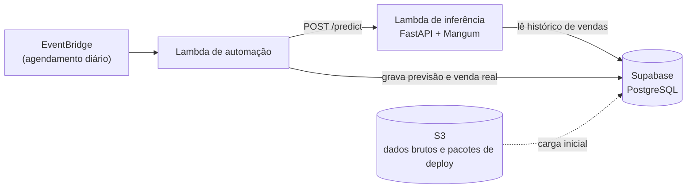

# API de Previsão de Demanda de Estoque

Pipeline de machine learning de ponta a ponta para prever a demanda diária de varejo: da análise exploratória ao modelo servido por uma API serverless, com histórico e previsões guardados em PostgreSQL. O foco do projeto não é a sofisticação do modelo, e sim a engenharia em volta dele: features sem vazamento de dados, validação temporal correta, comparação honesta contra um baseline e uma API que responde de forma estável e recusa pedidos inválidos com erros claros.

Dataset: [Store Item Demand Forecasting Challenge](https://www.kaggle.com/c/demand-forecasting-kernels-only) (Kaggle). São 5 anos de vendas diárias (2013–2017), 10 lojas × 50 itens e 913.000 registros.

## Status

| Etapa | Situação |
|---|---|
| Análise exploratória | Concluída |
| Modelo e avaliação | Concluído |
| Banco de dados (Supabase) e trigger de sincronização | Concluído |
| API de inferência, validada localmente | Concluída |
| Empacotamento para AWS Lambda (layer + função) | Concluído |
| Deploy na AWS Lambda | Em andamento |
| Automação diária (EventBridge + segunda Lambda) | Pendente |
| Dashboard de monitoramento do modelo (Power BI) | Pendente |

A demonstração ao vivo está prevista para ficar disponível até janeiro de 2027, o limite do plano gratuito da AWS usado no projeto. Depois disso, o repositório continua reproduzível a partir do código e dos scripts de build.

## Resultados

Modelo avaliado no último trimestre de 2017 (holdout fora da amostra de treino), comparado contra um baseline ingênuo (previsão = venda do mesmo dia da semana anterior):

| Modelo | MAE | RMSE |
|---|---|---|
| Baseline (naive, t-7) | 9,08 | 12,05 |
| **XGBoost** | **5,95** | **7,70** |

**Redução de cerca de 34,5% no erro absoluto médio (MAE)** em relação ao baseline.

## Arquitetura



- **Lambda de inferência:** carrega o modelo uma vez (cold start), lê os últimos 365 dias da série no banco, monta as features com o mesmo código do treino e devolve a previsão do dia seguinte.
- **Supabase (PostgreSQL):** histórico de vendas, previsões e o "relógio" da simulação.
- **S3:** cópia do dataset bruto e área de passagem do pacote de dependências da Lambda.
- **Lambda de automação e EventBridge:** ainda não implementados. A ideia é rodar uma vez por dia, pedir as previsões, registrar a venda real simulada do dia e avançar a data da simulação.

### Tempo simulado

O dataset termina em 31/12/2017, então o projeto usa uma data simulada em vez do relógio real. A tabela `sim_state` guarda o último dia com venda real conhecida, e a API prevê sempre o dia seguinte a ele.

## Banco de dados

| Tabela | Conteúdo |
|---|---|
| `sales_history` | Histórico real de vendas por loja, item e dia. Carga inicial com as 913.000 linhas do dataset. |
| `store_pred` | Previsões geradas, com a venda real preenchida depois que o dia acontece. Permite calcular MAE e RMSE ao longo do tempo. |
| `sim_state` | Uma única linha com a data simulada atual. |

Um **trigger** em `store_pred` (`AFTER UPDATE`) copia a venda real para `sales_history` assim que `actual_sales` é preenchido, usando `ON CONFLICT DO UPDATE` para que reprocessar o mesmo dia atualize a linha em vez de duplicá-la. Foi uma escolha deliberada: a sincronização vale para qualquer cliente que escreva na tabela, e não depende de cada script lembrar de gravar nas duas tabelas. O custo é que essa lógica fica no banco e não no código Python, por isso ela é documentada aqui.

<details>
<summary>SQL das tabelas e do trigger</summary>

```sql
CREATE TABLE sales_history (
  store int,
  item int,
  sale_date date,
  sale float NOT NULL,
  PRIMARY KEY (store, item, sale_date)
);

CREATE TABLE store_pred (
  store int,
  item int,
  forecast_date date,
  actual_sales float,
  predicted_sales float NOT NULL,
  created_at timestamp DEFAULT NOW(),
  PRIMARY KEY (store, item, forecast_date)
);

CREATE TABLE sim_state (
  id smallint PRIMARY KEY DEFAULT 1 CHECK (id = 1),
  simulated_date date NOT NULL
);

CREATE OR REPLACE FUNCTION sync_actual_sales()
RETURNS TRIGGER AS $$
BEGIN
  IF NEW.actual_sales IS NOT NULL THEN
    INSERT INTO sales_history (store, item, sale_date, sale)
    VALUES (NEW.store, NEW.item, NEW.forecast_date, NEW.actual_sales)
    ON CONFLICT (store, item, sale_date)
    DO UPDATE SET sale = EXCLUDED.sale;
  END IF;
  RETURN NEW;
END;
$$ LANGUAGE plpgsql;

CREATE TRIGGER trg_sync_actual_sales
AFTER UPDATE ON store_pred
FOR EACH ROW
EXECUTE FUNCTION sync_actual_sales();

-- Estado inicial da simulação
INSERT INTO sim_state (id, simulated_date) VALUES (1, '2017-12-31');
```

</details>

## API

`POST /predict`

```json
{ "store": 1, "item": 1 }
```

Resposta (a data prevista vem de `sim_state`, não do cliente):

```json
{
  "store": 1,
  "item": 1,
  "prediction_date": "2018-01-01",
  "demand_forecast": 12.746395111083984
}
```

| Status | Quando acontece |
|---|---|
| 422 | Loja ou item que o modelo não conhece; histórico vazio ou incompleto para a série |
| 500 | `sim_state` sem a linha inicial; linha de features montada para o dia errado |
| 503 | Banco indisponível depois de 3 tentativas de conexão |

O histórico precisa ter exatamente 365 dias consecutivos terminando na data simulada. Sem isso, o `lag_365` ficaria deslocado e a API responderia com a previsão de outro dia sem avisar, então ela recusa o pedido em vez de arriscar.

## Principais insights da análise exploratória

- **Padrão semanal claro:** as vendas crescem de segunda-feira (média 41,4) até domingo (média 62,1).
- **Sazonalidade anual:** pico em julho (média 67,0) e vale em janeiro (35,5).
- **Tendência de crescimento:** cerca de 35% de aumento na média entre 2013 e 2017, com desaceleração nos últimos anos.
- **Hierarquia estável entre lojas:** a loja 2 vende mais em todos os 5 anos e a loja 7 vende menos em todos os 5 anos. Todas as lojas crescem juntas, o que indica um efeito estrutural de loja separado da tendência geral.
- **Demanda regular:** 0% dos dias têm venda zero, o que valida uma regressão direta, sem técnicas para demanda esparsa.
- **Outlier investigado, não descartado:** a maior venda (231 unidades) caiu na loja 2, num domingo de julho, a combinação dos três fatores de maior volume, e não é um erro de dado.

## Principais decisões técnicas

**Modelagem**
- **Split temporal, não aleatório.** Treino com tudo antes de 01/10/2017 e teste no último trimestre. Embaralhar vazaria informação do futuro para o passado.
- **Features sem vazamento.** Lags (7, 14 e 365 dias) e médias móveis (7 e 14 dias) são calculados por `(store, item)`, com `shift` antes do `rolling`, para a janela nunca atravessar de uma série para outra nem incluir o dia previsto.
- **`store` e `item` como categorias, com a lista de categorias fixada e salva junto do modelo.** Sem isso, uma requisição com uma única linha receberia códigos categóricos diferentes dos do treino, e o modelo erraria sem lançar erro.
- **API nativa do XGBoost** (`xgb.train` e `DMatrix`) no lugar do wrapper do scikit-learn, para não carregar o scikit-learn no pacote da Lambda.
- **Baseline avaliado na mesma janela do modelo**, para a comparação ser justa.
- **Sem `early_stopping_rounds`.** Usar o conjunto de teste como `eval_set` deixaria o teste influenciar o número de árvores. Fazer isso direito exigiria um conjunto de validação separado.
- **Modelo exportado como bundle** (`model`, `feature_columns`, `test_start` e `categories`), para qualquer ambiente saber quais colunas usar e em qual ordem.

**Engenharia**
- **Uma única fonte para o código de features.** `src/features.py` é usado no treino e na API. Um script (`scripts/sync_shared_code.py`) copia o arquivo para a pasta da Lambda, e a cópia nunca é editada à mão. Isso evita o desvio entre treino e produção. Um teste de paridade confirmou que a linha de features montada pela API, para um dia que existe no CSV, é idêntica à calculada pelo pipeline de treino.
- **Janela de histórico derivada dos lags.** `HISTORY_DAYS = max(LAGS)` mora em `features.py` e é usado pela query, pela validação e pelo cálculo, então mudar um lag não deixa os três desencontrados.
- **Conexão com o banco tolerante a falhas.** `autocommit` (a API só lê), reabertura da conexão e até 3 tentativas apenas para erros de conexão. Um erro de SQL não é repetido, porque falharia do mesmo jeito. A falha final vira um erro próprio que a API traduz em 503, sem vazar detalhes internos.
- **Pooler do Supabase em modo transaction.** A conexão direta do plano gratuito usa IPv6, e uma Lambda fora de VPC só tem saída IPv4. O pooler compartilhado é IPv4 e gratuito.
- **Caminhos resolvidos a partir do arquivo** (`pathlib`), nunca como strings relativas ao terminal.
- **Credenciais só em variável de ambiente** (`DATABASE_URL`), fora do Git.

**Custo**
- **Só serviços Always Free**, sem EC2 nem RDS, que cobrariam depois do período gratuito.
- **Zip + Lambda Layers em vez de imagem de container.** A imagem exigiria o Amazon ECR, que não tem camada gratuita permanente.
- **`xgboost-cpu` no layer.** O pacote `xgboost` completo estouraria o limite de 250 MB da Lambda. O XGBoost exige o scipy em tempo de execução, então ele entra no layer.

## Como rodar

**1. Ambiente e treino**

```bash
python -m venv .venv
.venv\Scripts\activate        # Windows
pip install -r requirements.txt
python src/train.py
```

Isso gera `artifacts/model.pkl` (modelo e metadados) e `artifacts/metrics.json`. A pasta `artifacts/` precisa existir antes do treino.

**2. Banco de dados**

Crie um projeto no Supabase, rode o SQL da seção Banco de dados e carregue o histórico:

```bash
python scripts/backfill_sales_history.py
```

Crie um arquivo `.env` na raiz com a connection string do pooler do Supabase:

```
DATABASE_URL=postgresql://postgres.<ref-do-projeto>:<senha>@aws-0-<regiao>.pooler.supabase.com:6543/postgres
```

**3. API local**

```bash
python scripts/sync_shared_code.py
cd src/lambda_api
uvicorn handler:app --reload
```

A documentação interativa fica em `http://127.0.0.1:8000/docs`.

**4. Pacote para a Lambda**

```bash
python scripts/build_lambda.py
```

Gera `build/layer.zip` (dependências para Linux e Python 3.12) e `build/function.zip` (código e modelo). O script falha se o total passar do limite de 250 MB da Lambda. Tamanhos atuais: layer de cerca de 224 MB descompactado (70 MB de zip) e função de cerca de 6 MB, total de aproximadamente 230 MB.

## Estrutura do projeto

```
.
├── data/
│   └── train.csv                    # dataset bruto (não versionado)
├── notebooks/
│   └── 01_eda.ipynb                 # análise exploratória
├── src/
│   ├── features.py                  # engenharia de features (fonte única)
│   ├── train.py                     # split, baseline, treino, avaliação, exportação
│   └── lambda_api/
│       ├── handler.py               # API FastAPI + Mangum
│       ├── db.py                    # acesso ao PostgreSQL
│       ├── inference.py             # monta a linha de features de uma previsão
│       ├── schemas.py               # contrato de entrada e saída
│       ├── features.py              # cópia gerada (não editar)
│       └── model.pkl                # cópia gerada (não versionada)
├── scripts/
│   ├── backfill_sales_history.py    # carga inicial do histórico
│   ├── sync_shared_code.py          # copia features.py e model.pkl para a Lambda
│   └── build_lambda.py              # gera layer.zip e function.zip
├── artifacts/
│   ├── model.pkl                    # modelo e metadados (não versionado)
│   └── metrics.json                 # métricas de avaliação
├── requirements.txt                 # ambiente de desenvolvimento
├── requirements-lambda.txt          # dependências da Lambda
└── README.md
```

## Limitações conhecidas

- O modelo não é retreinado conforme a simulação avança. Como `year` é uma feature e o treino só viu 2013–2017, as previsões para 2018 em diante tratam o ano como o mais recente já visto.
- A venda "real" da simulação diária será gerada sinteticamente, então o monitoramento de acurácia no banco mostra o funcionamento do fluxo, e não o desempenho em dados de produção reais.
- O teste de paridade de features cobre uma data e uma série. Testes automatizados da API ainda não foram escritos.

## Próximos passos

- Deploy na AWS Lambda (layer pelo S3, função com Function URL e chave de API).
- Lambda de automação diária com EventBridge.
- Dashboard no Power BI conectado ao Supabase, com previsto contra real e MAE/RMSE ao longo do tempo.
- Exportar o schema do banco para `sql/schema.sql` no repositório.
- Testes automatizados da API (incluindo a reabertura de conexão).
